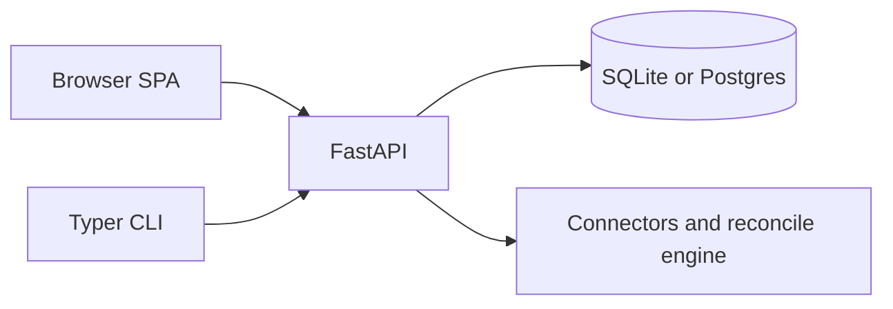
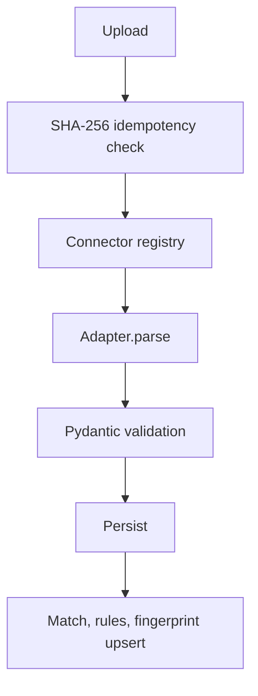

# Crypto Orbit Reconciliation Desk


**One clean ledger for a retail trader whose records are split across exchanges and a wallet — plus every exception that still needs a human, and an estimated India tax summary.**

Live demo: deploy the Render blueprint (`render.yaml`) and replace this line with the URL.


Replace the SVG placeholders with a hero GIF and screenshots after the first deploy (dark Overview, Exceptions with the drawer open, and a phone-width view).

## The problem

Aarav trades from Mumbai. His year is split across a WazirX-style CSV, a Binance-style CSV, and one on-chain wallet export. The files disagree on column names, time zones, decimal marks, and tickers. A withdrawal on the exchange should be the same coins that arrived in the wallet, but the amounts differ by a network fee and one of them never shows up at all. He does not want a trading bot. He wants one ledger, a list of the rows that do not add up, and a cautious estimate of tax before he talks to a CA.

## Features

- **Normalize** each file with a connector into one canonical transaction.
- **Reconcile** transfers by transaction hash, then by asset, time, and a 0.5% fee tolerance.
- **Exceptions** with severity, a plain-English explanation, a suggested fix, and a status that survives the next run.
- **FIFO tax estimate** in INR. Labelled ESTIMATE, not tax advice. Losses are not offset. TDS is informational.
- Works with **zero API keys**. Public addresses and CSV files only.

## Architecture

The browser is a React SPA. FastAPI is the core of the project: it owns ingestion, reconciliation, tax, webhooks, and the OpenAPI contract, and in production it serves the built SPA. The CLI calls the same services.



A trader uploads files. FastAPI hashes each file, detects a connector from the header, parses rows into canonical transactions, and enqueues a reconcile run. Bad rows become import issues instead of crashing the job.



The full container, sequence, ERD, frontend, and deploy diagrams are in [docs/architecture.md](docs/architecture.md). Decisions are in [docs/adr](docs/adr).

## Quick start

```bash
docker compose up --build
```

Open http://localhost:8000 and choose **Try with sample data**. You should see six open exceptions and one matched ETH transfer with a network fee of 0.0015.

Local development without Docker:

```bash
python -m venv .venv
.venv\Scripts\python -m pip install -e ".[dev]"   # Windows
uvicorn app.main:app --reload --port 8000
cd web && npm install && npm run dev
```

The Vite server on port 5173 proxies `/api` to FastAPI.

## Try it in 60 seconds

1. Open Overview. If the desk is empty, click **Try with sample data**.
2. Read the four summary cards and the orbit. Planets with open exceptions are marked.
3. Open **Exceptions**, filter to high severity, and open the unmatched ETH withdrawal.
4. Add a note and click **Resolve**. The five-second toast can undo it.
5. Open **Tax** and read the ESTIMATE banner before treating any number as advice.

## Seeded scenarios

| Scenario | Where | Exception |
| --- | --- | --- |
| Binance withdraws 1 ETH, wallet receives 0.9985 with the same hash | Binance + wallet | Not an exception. Match note: network fee 0.0015 |
| Binance withdraws 0.5 ETH with no wallet deposit | Binance | UNMATCHED_WITHDRAWAL |
| Wallet receives 1000 USDT with no exchange withdrawal | Wallet | UNMATCHED_DEPOSIT |
| One WazirX BTC buy repeated exactly | WazirX | DUPLICATE_TRADE |
| Sell 2 SOL after buying only 1.2 | WazirX | NEGATIVE_BALANCE |
| BTC buy about 12% off the fallback price | WazirX | PRICE_DEVIATION |
| Blank fee | WazirX | MISSING_FEE, plus an import warning |
| Title row, blank line, comma decimal, DD/MM/YYYY, bad date | Both CSVs | Bad date is an import issue, not an exception |
| Unknown headers | `unknown_exchange.csv` | 422 and the Map columns screen |

Details live in [sample-data/README.md](sample-data/README.md).

## How to add a new exchange

1. Copy the contract in [docs/writing-a-connector.md](docs/writing-a-connector.md).
2. Add `app/connectors/coindcx.py` with `detect` and `parse`.
3. Register it in `builtin_connectors()`.
4. Add a sample CSV and a test that asserts canonical rows and import issues.
5. Run `pytest tests/test_core.py`.

`detect` should key off a header signature, never a filename. `parse` must skip bad rows and return `ImportIssue` instead of raising.

## FDE skills demonstrated

| Skill | Where | Why it is here |
| --- | --- | --- |
| API design | `app/routers`, `app/schemas.py`, `/docs` | A customer integration needs a versioned contract, pagination, and one error shape. |
| Customer integration | `app/cli.py`, `app/services/webhooks.py`, `app/routers/webhooks.py` | The same desk has to run from cron, Slack, and an inbound transaction feed. |
| Data wrangling and SQL | `app/connectors`, `app/repositories/analytics.py` | Real files are messy, and running balances are a window query, not a loop in the UI. |
| Reliability | `app/services/jobs.py`, `app/reconcile/service.py` | Re-uploads and re-runs must not duplicate rows or reopen a decision. |
| Observability | `app/logging.py`, `app/metrics.py`, `/health`, `/ready` | A failed import needs a request id and a duration, not a blank 500. |
| Security | `app/deps.py`, `app/services/webhooks.py`, `app/services/export.py` | Untrusted files, no private keys, signed webhooks, SSRF checks, formula-safe exports. |
| AI-assisted workflows | `app/services/mapping.py` | A new CSV can be mapped with fuzzy matching. An LLM is optional and never trusted raw. |
| Delivery | `Dockerfile`, `.github/workflows/ci.yml`, `render.yaml` | One image, CI on SQLite and Postgres, a free-tier deploy path. |

## Customer integration notes

**Data we need:** CSV exports for each exchange, a wallet JSON (or a public address only if an Etherscan key is configured), the financial-year window, and which tickers are aliases.

**Assumptions:** trades are spot, wallets are ETH-style, tax is FIFO in INR, and fees are not cost unless `FEES_AS_COST` is turned on. We never ask for private keys or exchange API secrets.

**Discovery questions**

1. Which exchanges, and can you export the full year?
2. Which wallets, and are any of them Bitcoin or exchange sub-accounts rather than ETH-style?
3. Which financial year should the estimate cover?
4. How should airdrops and staking rewards be treated?
5. Do you want fees added to cost of acquisition?
6. Who will resolve exceptions, and what does "done" mean for a duplicate?
7. Where should high-severity alerts go (Slack, Discord, email webhook)?
8. Will this run beside the CA's spreadsheet for one quarter before it becomes the source of truth?

**Rollout:** pilot on one quarter of sample-shaped files, parallel run against the CA's sheet, then go-live with a named owner for open exceptions.

**Risks:** a wrong price or a missed wallet dominates the tax estimate. Mitigate with the price-deviation and unmatched-transfer exceptions, and with the estimate banner. SQLite on Render's free disk is ephemeral; use `DATABASE_URL` and Postgres before real customer data.

## Accessibility and performance

Target: WCAG 2.2 AA. Severity is icon plus text. Focus rings are visible. Drawers trap focus via Radix. Playwright runs axe and fails on serious or critical violations. Reduced motion stops the orbit animation and count-up. Route-level code splits the charts and the orbit. Lighthouse targets on Overview: Performance ≥ 90, Accessibility ≥ 95, Best Practices ≥ 95. Re-measure after you deploy; the scores are targets, not a claim about an unmeasured build.

## Repo tour

| Path | What it is |
| --- | --- |
| `app/` | FastAPI application, connectors, reconcile engine, routers |
| `web/` | React desk |
| `sample-data/` | The seeded files and the price fallback |
| `tests/` | Pytest |
| `docs/` | Architecture, ADRs, security, runbook, onboarding |
| `alembic/` | Schema migrations |

## API error codes

Every error is `{"error":{"code","message","details","request_id"}}`.

| Code | When |
| --- | --- |
| `UNSUPPORTED_FILE` | No connector matched. `details.files` lists headers for the mapping flow. |
| `VALIDATION_ERROR` | Body or query failed validation, or a resolution note was missing. |
| `UNAUTHORIZED` | Write call without a valid `X-API-Key` when demo mode is off. |
| `NOT_FOUND` | Unknown id. |
| `CONFLICT` | `Idempotency-Key` reused with a different payload. |
| `FILE_TOO_LARGE` | Size or row cap. |
| `RATE_LIMITED` | Upload or webhook limit. |
| `WEBHOOK_BLOCKED` | URL is missing or resolves to a private address. |
| `DEMO_DISABLED` | Reset called while `DEMO_MODE` is false. |
| `NOT_READY` | Database or migrations are not at head. |
| `INTERNAL` | Unhandled failure. The message stays generic; logs have the request id. |

## Limitations

No DeFi positions or NFTs. ETH-style wallet JSON only unless you add a connector. Tax is an estimate and FIFO only. Prices fall back to the bundled June–July 2024 file when CoinGecko is off or down.

## Roadmap

Connector profiles shared across a firm, a CA review export, and Bitcoin wallet support. Not in this desk: exchange API keys, private keys, or automated trading.

## Suggested GitHub description

Reconciliation desk for retail crypto records: FastAPI plus React, India tax estimate, exception workflow.

Topics: `crypto`, `fastapi`, `react`, `typescript`, `reconciliation`, `data-integration`, `forward-deployed-engineer`, `india-crypto-tax`
