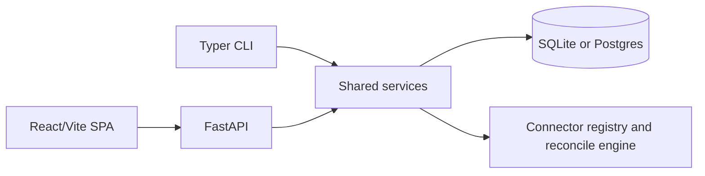
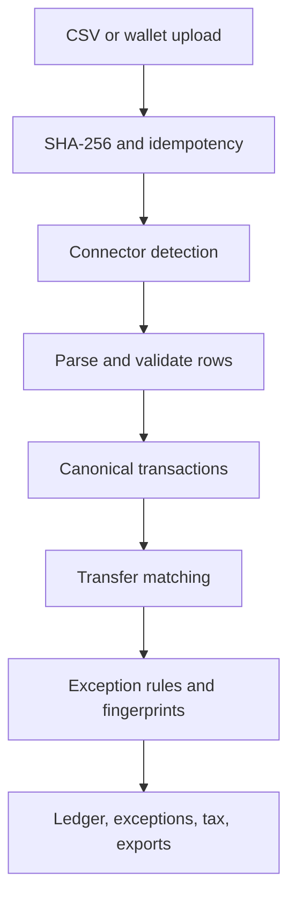

# Crypto Orbit Reconciliation Desk

[](https://github.com/riddhisc/Crpytoorbit/actions/workflows/ci.yml)
[](LICENSE)

Crypto Orbit is a reconciliation desk for retail crypto records spread across exchanges and wallets. It creates one canonical ledger, identifies records that do not reconcile, and produces an India-focused FIFO tax estimate.

It is designed for CSV and public-wallet workflows. It never asks for private keys or exchange API secrets.


## Contents

- [What it does](#what-it-does)
- [Architecture](#architecture)
- [Quick start with Docker](#quick-start-with-docker)
- [Local development](#local-development)
- [Using the application](#using-the-application)
- [Sample data](#sample-data)
- [API and CLI](#api-and-cli)
- [Configuration](#configuration)
- [Testing and CI](#testing-and-ci)
- [Adding a connector](#adding-a-connector)
- [Deployment](#deployment)
- [Security and limitations](#security-and-limitations)
- [Repository tour](#repository-tour)

## What it does

### Ingestion and normalization

- Accepts exchange CSV files and ETH-style wallet JSON.
- Detects a connector from the file header rather than relying on the filename.
- Normalizes column names, date formats, decimal formats, tickers, and time zones into a canonical transaction model.
- Treats malformed rows as import issues so one bad row does not discard the entire file.
- Uses file hashes and transaction fingerprints to make re-uploads and reconciliation runs idempotent.

### Reconciliation

Transfers are matched in stages:

1. Exact transaction-hash matches.
2. Asset and time-window matching.
3. Quantity matching with the configured network-fee tolerance.

Unmatched transfers, duplicate trades, missing fees, price deviations, and negative balances become exceptions. Each exception has a severity, explanation, suggested fix, evidence, status, and resolution history.

### Tax estimate

The tax view calculates a FIFO estimate in INR. The result is intentionally labelled **ESTIMATE, not tax advice**. The current model is limited to spot-style records, does not offset losses, and reports TDS as informational. Verify all results with a qualified tax professional.

## Architecture

The project has one FastAPI application and a React/Vite frontend. FastAPI owns ingestion, reconciliation, tax calculations, exports, webhooks, health checks, and the OpenAPI contract. The CLI uses the same service layer as the API.



The production Docker image builds the frontend first, copies the generated `web/dist` directory into the Python image, and serves the SPA from FastAPI. During local development, Vite runs separately and proxies `/api` to port 8000.



More detail is available in [docs/architecture.md](docs/architecture.md). Design decisions are recorded in [docs/adr](docs/adr).

## Quick start with Docker

Docker is the simplest way to run the complete application:

```bash
docker compose up --build
```

Open [http://localhost:8000](http://localhost:8000). The default Compose configuration uses demo mode and stores SQLite data in the named `orbit-data` volume.

To stop the application:

```bash
docker compose down
```

To remove the local demo database as well:

```bash
docker compose down -v
```

The Postgres service is optional and is enabled with the `postgres` profile:

```bash
docker compose --profile postgres up -d postgres
```

## Local development

### Prerequisites

- Python 3.11 or newer
- Node.js 20 or newer
- npm
- Optional: Docker Desktop

### Backend setup

Windows PowerShell:

```powershell
python -m venv .venv
.\.venv\Scripts\Activate.ps1
python -m pip install -e ".[dev]"
uvicorn app.main:app --reload --port 8000
```

macOS/Linux:

```bash
python3 -m venv .venv
source .venv/bin/activate
python -m pip install -e ".[dev]"
uvicorn app.main:app --reload --port 8000
```

The API is available at [http://localhost:8000](http://localhost:8000). OpenAPI documentation is available at `/docs`, and the raw schema is at `/openapi.json`.

### Frontend setup

In a second terminal:

```bash
cd web
npm install
npm run dev
```

Open [http://localhost:5173](http://localhost:5173). Vite proxies `/api`, `/health`, `/ready`, and `/metrics` to the FastAPI server on port 8000.

### Useful Make targets

```bash
make dev       # Start FastAPI with reload
make test      # Backend coverage plus frontend tests and typecheck
make lint      # Ruff, mypy, ESLint, and TypeScript checks
make demo      # Import the bundled sample files through the CLI
```

On Windows, run the underlying commands directly if `make` is not installed.

## Using the application

1. Open **Overview**.
2. Select **Try with sample data** when the desk is empty, or open **Import** to upload files.
3. Review the summary cards and holdings orbit.
4. Open **Exceptions** and filter by status, severity, asset, or text.
5. Open an exception to review its evidence and suggested fix.
6. Add a resolution note and select **Resolve**, **Ignore**, or **Reopen**.
7. Review the **Tax** page and export a ledger or exception CSV when needed.

The demo data should produce one matched ETH transfer with a 0.0015 network fee and several intentional exceptions, including an unmatched withdrawal, unmatched deposit, duplicate trade, negative balance, price deviation, and missing fee.

## Sample data

The files in `sample-data/` represent common messy inputs:

| File | Purpose |
| --- | --- |
| `wazirx_trades.csv` | WazirX-style trade export with duplicate and missing-fee cases |
| `binance_trades.csv` | Binance-style trade and withdrawal export |
| `wallet_transfers.json` | ETH-style wallet transfer records |
| `unknown_exchange.csv` | Unknown headers for the mapping flow |
| `prices_fallback.json` | Offline INR price fallback used when online prices are disabled |

See [sample-data/README.md](sample-data/README.md) for the expected scenarios and connector details.

## API and CLI

### Health and operations endpoints

| Endpoint | Purpose |
| --- | --- |
| `GET /health` | Liveness check |
| `GET /ready` | Database and Alembic readiness check |
| `GET /metrics` | Prometheus text metrics |
| `GET /docs` | Interactive Swagger UI |
| `GET /openapi.json` | OpenAPI schema |

### Main API areas

| Area | Examples |
| --- | --- |
| Summary and ledger | `GET /api/v1/summary`, `GET /api/v1/ledger` |
| Imports | `POST /api/v1/imports`, `GET /api/v1/imports/{job_id}` |
| Exceptions | `GET /api/v1/exceptions`, `PATCH /api/v1/exceptions/{id}` |
| Tax | `GET /api/v1/tax` |
| Exports | `GET /api/v1/export/ledger.csv`, `GET /api/v1/export/exceptions.csv`, `GET /api/v1/export/report.pdf` |
| Demo | `POST /api/v1/demo/load`, `POST /api/v1/reset` |
| Webhooks | `POST /api/v1/webhooks/transactions` |

All API errors use a common structure:

```json
{
  "error": {
    "code": "VALIDATION_ERROR",
    "message": "A human-readable explanation",
    "details": {},
    "request_id": "..."
  }
}
```

### CLI examples

After installing the package, use the `orbit` command:

```bash
orbit import sample-data/wazirx_trades.csv sample-data/binance_trades.csv sample-data/wallet_transfers.json
orbit reconcile
orbit exceptions --status open
orbit exceptions --status open --severity high
orbit export --format csv
orbit export --format exceptions
```

The CLI calls the same database and reconciliation services as the API. It runs migrations before each command.

## Configuration

Settings are read from environment variables, with `.env` support through Pydantic Settings. Common variables are:

| Variable | Default | Description |
| --- | --- | --- |
| `DEMO_MODE` | `true` | Enables sample loading and unauthenticated write operations. Set to `false` outside demos. |
| `API_KEY` | empty | Required for write calls when demo mode is disabled; clients send `X-API-Key`. |
| `DATABASE_URL` | `sqlite:///./data/orbit.db` | SQLite or Postgres connection URL. |
| `PRICES_ONLINE` | `false` | Enables optional CoinGecko lookups before fallback prices. |
| `CORS_ORIGINS` | local ports | Comma-separated allowed browser origins. |
| `TRANSFER_WINDOW_HOURS` | `6` | Maximum transfer matching time window. |
| `TRANSFER_TOLERANCE_PCT` | `0.5` | Quantity tolerance used for network fees. |
| `PRICE_DEVIATION_PCT` | `8` | Threshold for a price-deviation exception. |
| `FEES_AS_COST` | `false` | Whether fees are included in acquisition cost for the estimate. |
| `ANTHROPIC_API_KEY` | empty | Optional key for assisted column mapping; the application works without it. |

For a production deployment, set `DEMO_MODE=false`, configure `API_KEY`, use Postgres for durable storage, and restrict `CORS_ORIGINS` to known frontend origins.

## Testing and CI

### Backend

```bash
pytest -q --cov=app --cov-fail-under=85
ruff check app tests
ruff format --check app tests
mypy app
```

### Frontend

```bash
cd web
npm run typecheck
npm test
npm run lint
```

### End-to-end tests

The Playwright configuration starts both the FastAPI server and Vite server. Install the backend package first, then install Chromium:

```bash
python -m pip install -e .
cd web
npm install
npx playwright install --with-deps chromium
npm run e2e
```

The E2E tests reset and load their own SQLite database, exercise the sample-data flow, resolve an exception, check accessibility with axe, and verify CSV download behavior.

GitHub Actions runs backend checks against SQLite and Postgres, frontend unit/type checks, Playwright, and the Docker build. The workflow is [`.github/workflows/ci.yml`](.github/workflows/ci.yml).

## Adding a connector

Read [docs/writing-a-connector.md](docs/writing-a-connector.md), then:

1. Add a module under `app/connectors/` with `detect` and `parse` behavior.
2. Register the connector in `builtin_connectors()`.
3. Detect by header signature, not by filename.
4. Normalize rows into the canonical transaction schema.
5. Return import issues for bad rows instead of raising for the whole file.
6. Add representative sample data and tests for valid rows, malformed rows, dates, decimals, and duplicate handling.
7. Run the backend tests and the connector-specific tests.

## Deployment

### Docker

The root `Dockerfile` builds the web application and packages it with FastAPI. Build and run it directly with:

```bash
docker build -t crypto-orbit .
docker run --rm -p 8000:8000 crypto-orbit
```

### Render

`render.yaml` provides a Docker web-service blueprint. Before using it with real data:

- Set `DEMO_MODE=false`.
- Set a strong `API_KEY` secret.
- Use a durable Postgres `DATABASE_URL` rather than local SQLite.
- Configure the correct `CORS_ORIGINS`.
- Confirm `/ready` is healthy after deployment.

SQLite on an ephemeral hosting disk is suitable for demos only; data can be lost when the instance is replaced.

## Security and limitations

Security measures include request IDs, structured logs, signed webhook payloads, private-address checks for outbound webhook URLs, formula-safe CSV exports, upload limits, and API-key protection for write operations outside demo mode. See [docs/security.md](docs/security.md).

Current limitations:

- No DeFi positions or NFT accounting.
- ETH-style wallet JSON only unless another connector is added.
- FIFO tax estimate only.
- No loss offsetting in the current tax model.
- Prices use the bundled fallback file when online lookups are disabled or unavailable.
- The estimate is not tax advice and must be reviewed before filing or making financial decisions.

## Repository tour

| Path | Purpose |
| --- | --- |
| `app/` | FastAPI application, services, models, routers, connectors, and reconciliation engine |
| `web/` | React/Vite frontend, pages, components, API client, and E2E tests |
| `sample-data/` | Seed files and offline price fallback |
| `tests/` | Backend unit and API tests |
| `docs/` | Architecture, security, runbook, onboarding, and connector guidance |
| `alembic/` | Database migrations |
| `Dockerfile` | Multi-stage production image |
| `docker-compose.yml` | Local Docker development stack |
| `.github/workflows/ci.yml` | Backend, frontend, Playwright, and Docker CI |

## Further documentation

- [Architecture](docs/architecture.md)
- [Security notes](docs/security.md)
- [Operations runbook](docs/runbook.md)
- [Customer onboarding](docs/customer-onboarding.md)
- [Writing a connector](docs/writing-a-connector.md)
- [Sample-data guide](sample-data/README.md)
- [Architecture decision records](docs/adr)

## License

This project is licensed under the MIT License. See [LICENSE](LICENSE).
