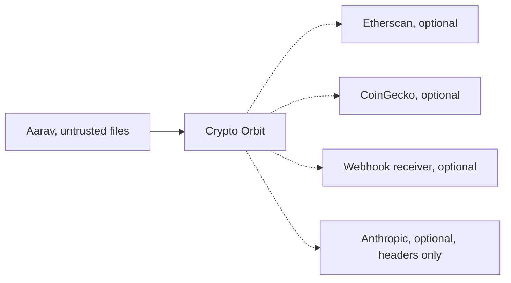
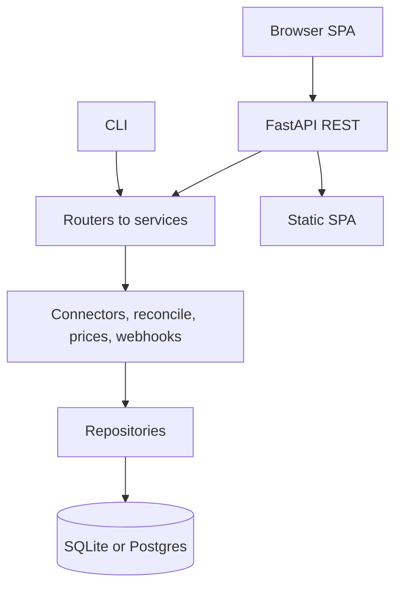
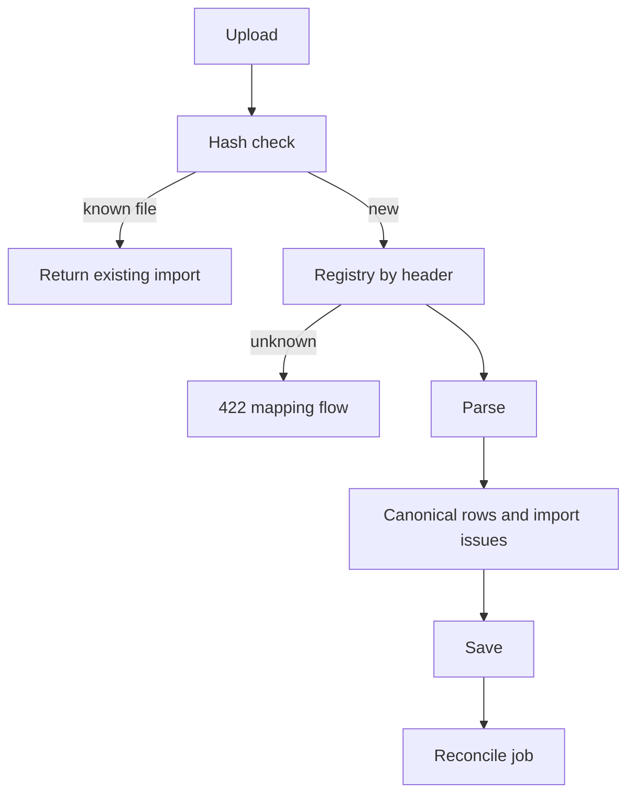
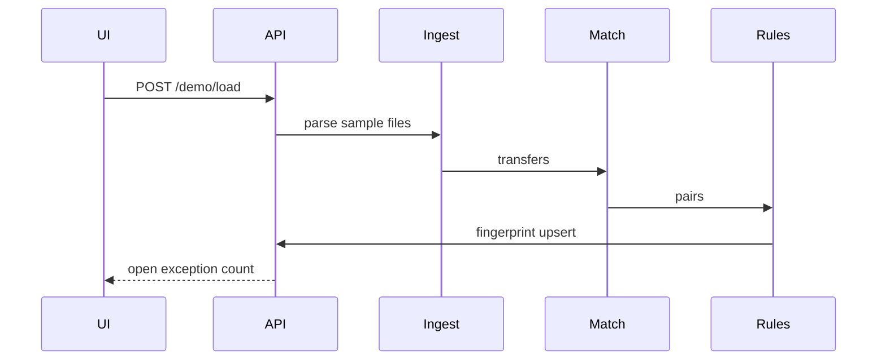
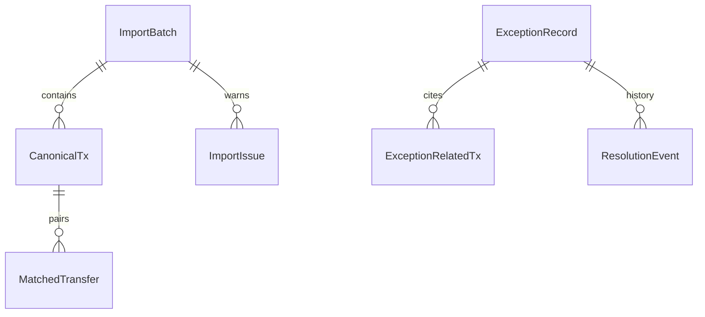

# Architecture

Crypto Orbit is one deployable app. FastAPI is the system of record. The React desk is a client of its OpenAPI contract. Design principles: every exception explains itself, bad rows never crash a file, imports are idempotent, a new exchange is one connector file, and the UI is accessible by default.

## 14.1 System context

A trader sends untrusted files. Optional external systems are Etherscan (only with a key, public address only), CoinGecko (prices), a webhook receiver, and Anthropic (headers plus five sample rows, and only if a key is set). No private keys enter the system. Files and inbound JSON are untrusted. The database and the fallback price file are trusted after validation.

The trader is outside the trust boundary. Connectors validate every row. The LLM never writes a transaction by itself.

## 14.2 Containers

Routers depend on services. Services depend on connectors and the repository. The CLI imports the services directly so a cron job does not need a second implementation.

## 14.3 Ingestion

Identical bytes return the existing import. An unknown header returns 422 with the detected headers so the UI can map columns.

## 14.4 Reconcile sequence

The UI calls `POST /api/v1/demo/load`. Ingest parses the three sample files. The matcher pairs by hash, then by asset, time window, and quantity tolerance. The rules engine emits the seven exception types. Fingerprints upsert so a resolved row stays resolved. New high-severity exceptions can dispatch a signed webhook. The UI refetches summary and exceptions through TanStack Query.

## 14.5 Data model

ImportBatch 1—N CanonicalTx and ImportIssue. ExceptionRecord has a unique fingerprint and N ExceptionRelatedTx. MatchedTransfer links an out id to an in id. ResolutionEvent is the audit log. ConnectorProfile stores a header signature and a mapping. WebhookDelivery logs each attempt. Job and IdempotencyKey cover background imports. PriceCache stores INR prices. Indexes: `(asset, ts_utc)` for the balance window and ledger filters, `tx_hash` for matching, unique `fingerprint` so resolutions survive a re-run.

## 14.6 Frontend

Routes render pages. Pages use feature components and the UI kit. TanStack Query is the server cache, keyed by the URL filter string. Zustand holds theme, sidebar, and toasts. Design tokens live in `web/src/design/tokens.css`.

## 14.7 Deployment

GitHub Actions lints, typechecks, tests on SQLite and Postgres, runs Playwright, and builds the Docker image. Render's free web service runs that image. SQLite on the free disk is ephemeral: a restart can drop the file. That is acceptable for the demo and wrong for a customer. Set `DATABASE_URL` to Postgres (the compose profile `postgres`) before real data lands.

See [security.md](security.md), [runbook.md](runbook.md), and [customer-onboarding.md](customer-onboarding.md).
